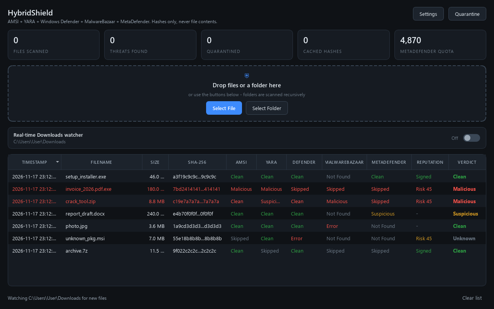
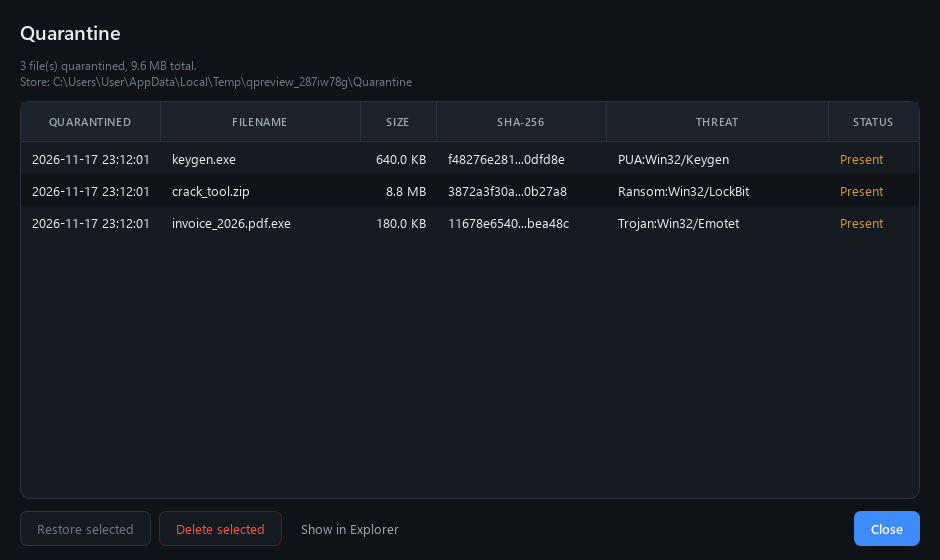

# HybridShield

A Windows desktop file scanner that combines seven detection layers behind one
dashboard. Built with Python 3.12+, PySide6, watchdog, httpx and SQLite.

**Privacy model: only SHA-256 hashes leave your machine.** File contents are
never uploaded to MalwareBazaar or MetaDefender. The hash is computed locally in
64 KiB chunks and that is the only thing sent over the wire.



---

## What it does

| Layer | Source | Cost | What it answers |
|---|---|---|---|
| 0 | Local SQLite cache | free | "Did I already scan this exact file in the last 24h?" |
| 1 | **AMSI** (in-process) | free, local | "Does Defender's engine flag this content?" - milliseconds |
| 2 | **YARA rules** (built-in corpus) | free, local | "Does this file *behave* like ransomware or a credential dumper?" |
| 3 | Windows Defender CLI (`MpCmdRun.exe`) | free, local | "Does this machine's own AV engine flag it?" - slower, more detail |
| 4 | MalwareBazaar (abuse.ch) | API quota | "Is this hash a known malware sample?" |
| 5 | OPSWAT MetaDefender Cloud | API quota | "How many of ~25 engines flag this hash?" |
| 6 | **Local reputation** | free, offline | "Where did it come from, who signed it, what does its code look like?" |

The cache is checked first. A hit inside the TTL returns the stored verdict and
spends **zero** API quota, so rescanning a folder you already scanned is free.

AMSI runs first among the scanners because it is a function call, not a
subprocess. A positive result is conclusive and skips everything else.

### Why a YARA layer

Every other layer answers "is this exact file known bad?". A brand-new sample
has no hash reputation anywhere, so MalwareBazaar and MetaDefender both say
`Not Found` and the file reads Clean. YARA is the layer that can still say
something useful about a file nobody has ever seen: it matches *behaviour*
(ransomware note text, credential-dumping strings, PowerShell download
cradles, LOLBin abuse, webshell patterns) rather than identity.

The engine is a pure-Python YARA subset in `scanner/yara_engine.py` - no C
toolchain, no `yara-python` wheel to fail on. It supports text strings with
`nocase`/`wide`/`ascii`/`fullword`, hex strings with wildcards and jumps,
regexes, `any`/`all`/`N of them`, `N of ($a*)`, `$a at offset`, `#a` match
counts, `filesize`, and integer comparisons.

Unsupported constructs (`pe.`/`math.` modules, `for` loops, `xor`, percentages)
**fail to compile with a clear message** rather than silently never firing. A
rule that quietly never matches is indistinguishable from a rule that found
nothing, which is the one failure mode a detection layer cannot afford.

Severity maps one-directionally, matching the reputation layer's contract: a
`critical`/`high` rule hit is **Malicious**, `medium`/`low` is **Suspicious**,
and a miss is Clean. A rule hit can never lower a verdict.

The corpus ships in `scanner/rules/builtin.yar` (16 rules) and is matched
against the first 32 MiB of each file, read through the same locked handle that
was hashed - so the rules provably inspect the bytes the hash describes.

**Calibration.** A rule that fires on routine admin commands trains the user to
ignore alerts, which is worse than not having the rule. Every rule requires the
discriminator that separates abuse from ordinary use, not just the presence of a
binary name:

- `LOLBin_Abuse` needs a remote URL alongside the fetch verb. `certutil
  -urlcache * delete` is standard Windows housekeeping and does not fire;
  `certutil -urlcache -split -f http://...` does.
- `Ransomware_Extension_Targeting` needs four document extensions, not three,
  because a security write-up about ransomware also names extensions next to
  `CryptEncrypt` and `DeleteFile`.
- `Cryptominer_Indicators` needs three miner terms, or a wallet plus two, so a
  news article mentioning Monero and RandomX stays quiet.
- `Suspicious_Base64_Blob` needs a decode primitive (`base64_decode`,
  `FromBase64String`, `atob(`), not the bare word `base64`, so an inline
  `data:image/png;base64,...` image is not an obfuscated payload.
- `Tor_Onion_Reference` needs a `socks5://` URL, not the word `socks5`.

**Measured against real software.** The rules are swept over files sampled
from `System32`, `SysWOW64` and `Program Files` on a working Windows machine
(`tools/sweep_yara.py`). The first pass flagged 17 of 4,000 files (0.42%) -
including `kernel32.dll`, `wer.dll`, `comsvcs.dll` and `curl.exe` at high or
critical severity, which would have quarantined signed system binaries.

After calibration the corpus is clean over a 19,847-file sweep: **zero hits,
zero read errors** (5,000 each from `System32`, `Program Files` and
`Program Files (x86)`, 4,847 from `SysWOW64`). Every false positive that sweep
surfaced was fixed at the rule, not by widening a threshold.

The sweep found a systemic problem rather than a few loose thresholds: rules
were matching **API names and registry paths that appear in the import and
string tables of legitimate software**. `Process_Injection_APIs` fired on
`kernel32.dll`, which *exports* all four functions. `Credential_Dumping_Strings`
fired on `wer.dll` via `MiniDumpWriteDump` + `\SECURITY`, a generic registry
hive name. `LOLBin_Abuse` fired on `scrobj.dll`, the scriptlet engine itself.
Each now requires the discriminator that makes the behaviour malicious (an
injection target, `lsass.exe`, a caller) rather than the mere presence of a
name.

`Scheduled_Task_Persistence` was the last one standing: it fired on
`RCoInstII64.dll`, the Realtek audio installer, which legitimately runs
`schtasks /create /Tn %s /XML "%s" /F` to register its own task. `/create`
plus a task name is an installer doing its job. The rule now requires the
discriminator that separates persistence from installation - a recurrence or
trigger (`/sc minute`, `/sc onlogon`, `/sc daily`, ...) or `/ru SYSTEM` - and
its flags are anchored on a following space, because a bare `/tr` was also
matching inside `/TRUEHARMONY` in that same binary.

`Suspicious_Base64_Blob` had the same shape of problem. Length does not
separate a payload from ordinary data: the longest base64-looking run in
`EpicOnlineServicesUserHelper.exe` is 3.5 MB, while a genuine encoded PE is
13 KB. What separates them is structure - a real payload is passed *into* the
decoder - so the rule requires `base64_decode`/`FromBase64String`/`atob(`
followed by a quoted 200+ character run, not a bare long blob.

`Double_Extension_Executable` was **removed from the corpus entirely**. It
described a filename property, and a content rule for it matched the literal
string `.com` inside any binary mentioning a URL - which is how `curl.exe` was
flagged as Malicious. It now lives in `scanner/reputation.py` as
`double_extension()`, where the path is actually available.

`tools/verify_yara_fp.py` holds this line with 60 checks over realistic benign
content (admin scripts, installers, developer tooling, documents) plus a
regression block for each false positive found during calibration. It also
audits every rule for **dead strings** - a string declared but never reachable
from the condition makes a rule look stronger than it is. That audit caught
`$p8 = "Net.WebClient"` sitting unreachable in `PowerShell_Download_Cradle`,
the most common cradle primitive in the corpus.

`tools/verify_yara_recall.py` is the counterweight: 36 checks that real attack
shapes (mimikatz, LSASS dumping, certutil/bitsadmin/mshta/regsvr32 cradles,
encoded commands, injection into lsass, ransomware notes, webshells, miners,
scheduled-task persistence by recurrence and by SYSTEM) still fire after
calibration, plus every sweep false positive staying fixed. Tightening a rule
is only safe when both suites pass.

### Local reputation signals

Layer 5 is the one that adds judgment a bare antivirus verdict cannot give you.
All three checks are offline and free:

**MOTW (Mark of the Web).** A file downloaded from the internet carries a
`Zone.Identifier` alternate data stream with `ZoneId=3`. Defender does not
surface this. "Clean but arrived from the internet" is a different decision from
"clean and was already on this machine", and the app now distinguishes them.

**Authenticode.** Is the binary signed, and by whom? Two-stage: `WinVerifyTrust`
for an embedded signature, then a catalog lookup when there is none. That second
stage matters - `notepad.exe` and `cmd.exe` are **catalog-signed**, with no
signature inside the file, so a naive check calls them unsigned. They are not.

**PE heuristics.** Section entropy (a section at ~7.5+ bits/byte is packed or
encrypted), import-table shape (no imports = packed stub), and the
process-injection API triad (`VirtualAllocEx` + `WriteProcessMemory` +
`CreateRemoteThread`). Pure-Python PE parsing, no `pefile` dependency.

These signals are **advisory and one-directional**: they can raise `Clean` to
`Suspicious`, and they can never lower a verdict. A signature engine saying
Malicious always wins over a heuristic saying "looks fine".

Calibration: unsigned executable (25) + internet download (20) = 45, which
crosses the 40 threshold. That combination - an unsigned binary that arrived
from the internet - is the most common shape of a malicious download, so it must
not land just under the line. A valid signature subtracts 15, which is why a
signed file downloaded from the internet stays Clean at risk 5.

### Why AMSI matters

`MpCmdRun.exe` is a thin CLI over Defender's engine: every call pays process
startup and engine handshake. AMSI (`AmsiScanBuffer`) reaches the same engine
in-process. Measured on this machine: **~16 ms vs ~64 ms per file**, and the gap
widens with file count because the CLI's fixed cost is paid per file.

AMSI also scans *content*, so a file deleted immediately after being read is
still scanned. It reports a verdict, not a signature name - the CLI is still
there when you want the detail.

**AMSI requires Windows Defender real-time protection to be on.** The AMSI
provider is only registered while RTP is active; with RTP off, every scan
returns `ERROR_NOT_READY`. The app detects this and reports
`Skipped - AMSI unavailable: real-time protection is turned off` rather than
silently degrading.

---

## Requirements

- Windows 10 or 11
- Python 3.12 or newer
- Windows Defender enabled (for Layer 1; the app still works without it, but
  the local layer reports `Skipped`)

### API keys (optional, both free tiers exist)

- **MalwareBazaar** — register at <https://auth.abuse.ch/> and copy your Auth-Key.
- **OPSWAT MetaDefender Cloud** — register at <https://portal.opswat.com/> and
  copy your API key.

Both are optional. With no keys the app still hashes files, runs Defender, and
caches results; the two cloud columns just read `Skipped`.

---

## Install and run

```bat
pip install -r requirements.txt
python main.py
```

Or use the build script, which creates a virtual environment, installs
dependencies and packages the app:

```bat
build.bat
```

Output: `dist\HybridShield\HybridShield.exe`. Ship the **whole folder**, not just
the `.exe`.

---

## Using it

1. **Scan something.** Drop files or a folder onto the drop zone, or use
   *Select File* / *Select Folder*. Folders are walked recursively.
2. **Add your keys.** *Settings* → paste the MalwareBazaar Auth-Key and the
   MetaDefender key. *Check quota* reads the live `X-RateLimit-Remaining` value
   from MetaDefender without spending a lookup (it probes a hash OPSWAT already
   has on record).
3. **Turn on the watcher.** The toggle starts monitoring your Downloads folder.
   New files are scanned automatically once their write actually finishes.
4. **Minimise.** Closing the window sends the app to the system tray. A native
   Windows toast fires whenever a malicious file is detected, and the window
   comes forward so the alert is not missed. Right-click the tray icon to quit.

Right-click any row for *Rescan*, *Show in Explorer*, *Copy SHA-256* and
*Copy full path*.

---

## Reading the results

The verdict column is the only thing you need at a glance:

| Verdict | Meaning |
|---|---|
| **Malicious** | At least one layer positively identified a threat. |
| **Suspicious** | A layer flagged it without a firm detection, or local signals (unsigned + downloaded, packed, injection APIs) warrant caution. |
| **Clean** | Defender inspected the bytes and found nothing, and no layer errored. |
| **Unknown** | Nobody actually inspected the bytes — e.g. Defender failed and the cloud layers had no record. |
| **Error** | The file could not be read or scanned. |

**`Unknown` is deliberately not `Clean`.** If Defender errored out and both
cloud lookups returned "not found", the honest answer is that no engine ever
looked at the file. Reporting that as clean would be a silent false negative,
which is the one failure mode a scanner cannot afford.

`Not Found` in a cloud column means the provider has never seen that hash. That
is *not* the same as clean — a brand-new file is not in anyone's corpus yet.

---

## Security properties

These are the things that make the difference between a dashboard and a
defence. Each one is covered by a test.

**Detections are removed from disk, not just reported.** A file flagged
malicious is moved into `%LOCALAPPDATA%\HybridShield\Quarantine`, renamed to
`.quar`, marked read-only, and ACL-locked to your user. Windows has no handler
for `.quar`, so a double-click cannot execute it even if someone drags it back
out by hand. The original path, hash, size and threat detail are recorded before
the move, so a crash mid-move still leaves an audit trail.

The move happens **after the scan handle is released**. `LockedFile` holds the
file with `dwShareMode = FILE_SHARE_READ`, which denies delete, so moving it
while that handle is open fails with a sharing violation every time. The TOCTOU
guarantee only needs to cover hashing and the Defender scan; once the verdict is
decided the handle has done its job. `tools/verify_yara_impact.py` proves both
halves: a file that trips a medium-severity rule is Suspicious and stays on
disk, while a critical rule detection is quarantined and leaves disk. It also
holds the Realtek installer case - a signed system DLL that legitimately
schedules tasks must come back Clean, not Suspicious.

**Restore verifies the bytes first.** Re-hashing the quarantined file and
comparing against the hash recorded at quarantine time means a tampered store
cannot launder a different payload back onto disk under a trusted filename. A
mismatch refuses the restore outright.

**The hash and the scan describe the same bytes (TOCTOU defence).** The file is
opened once with a handle that denies writes and deletes (`dwShareMode =
FILE_SHARE_READ`), and that handle is held across hashing *and* the Defender
scan. Readers are still allowed, because Defender must read the file. Without
this, an attacker with a local write primitive can swap the file between the
hash and the scan, and the cache then serves a Clean verdict for a hash that
never matched the scanned content. A post-scan stat check catches filesystems
that ignore share modes.

**API keys are encrypted at rest with DPAPI.** `settings.json` holds
`CryptProtectData` ciphertext bound to your Windows user account, not plaintext.
Another account on the same machine, or the file copied elsewhere, cannot
decrypt it. There is no key stored anywhere, so there is no key to steal.
Legacy plaintext settings still load and are upgraded on the next save.

**A file the OS refuses to open is a detection, not an error.** Windows returns
`ERROR_VIRUS_INFECTED` (225) from `CreateFileW` when antivirus has flagged a
file. The metadata still exists, so a naive `is_file()` check passes and the
open then fails. Reporting that as "Error: cannot open file" would be a false
negative on exactly the files that matter most. It is reported as **Malicious**,
and deliberately not written to the hash cache (there is no hash to key it on).

**Folder walks do not escape through junctions.** A junction inside the target
(`Downloads\link -> C:\Windows`) would otherwise make the walker traverse the
entire system. Reparse points are detected and skipped.

**The watcher does not leak.** The "already dispatched" set is bounded and
TTL-expired, so a tray app running for weeks cannot grow it without limit, and a
file re-downloaded to the same path is scanned again.

---

## Quarantine

Auto-quarantine is **on by default**. When a scan returns Malicious:

1. The file is moved into the quarantine store (ACL-locked to your account).
2. It is renamed `.<hash>.quar` - no Windows handler, so it cannot execute.
3. It is marked read-only and denied execute permission.
4. A record is written with the original path, hash, size and threat detail.



Open **Quarantine** from the header or the tray menu to review, restore or
delete. Restoring asks for confirmation and re-verifies the hash first.
Deleting overwrites the bytes before unlinking - best effort, and not a
guarantee on SSDs where wear levelling may keep the original blocks.

If Windows Defender has already removed or locked a file, it cannot be moved.
That is reported as *"Antivirus is already handling it"* rather than as an
error: the threat is handled, just not by us.

Turn it off in Settings if you want scan-only behaviour and prefer to act on
findings yourself.

---

## How the watcher avoids scanning half-downloaded files

A naive watchdog handler fires on the first `created` event, which for a browser
download is before any bytes exist. Hashing then produces a hash that matches
nothing and caches a meaningless verdict. HybridShield gates on three things:

1. **Debounce** — the file must be quiet for 3 seconds. Every new write event
   resets the timer, so a 2 GB download that keeps growing is never scanned
   mid-flight.
2. **Exclusive-share probe** — on Windows the file is opened with
   `dwShareMode = 0`. If any other handle has it open, Windows returns
   `ERROR_SHARING_VIOLATION`. That is the definitive "still in use" signal.
3. **Size stability** — the size is re-checked after the lock probe passes; if
   it grew, the file goes back in the queue.

Partial-download artefacts (`.crdownload`, `.part`, `.tmp`, `.!ut`, `.aria2`,
`.opdownload` and friends) are ignored outright, and the final renamed file is
picked up instead.

---

## Where your data lives

Everything is under `%LOCALAPPDATA%\HybridShield\`:

| File | Contents |
|---|---|
| `settings.json` | API keys (**DPAPI-encrypted**), watch folder, preferences. |
| `scan_history.db` | SQLite: the 24h hash cache, the scan log, and quarantine records. |
| `Quarantine\` | Quarantined files, renamed `.quar`, read-only, ACL-locked. |
| `hybridshield.log` | Rotating log, 2 MB × 3 files. Never contains API keys. |

API keys are never logged, never written to the database, and never included in
scan results. They are sent only to the provider that issued them, in that
provider's own authentication header.

---

## Project layout

```
main.py                  entry point, logging, single-instance guard
scanner/
    config.py            paths, settings store, DPAPI secret encryption
    database.py          SQLite cache, scan history, quarantine records
    engine.py            locked-handle hashing, cache gate, layers, aggregation
    amsi.py              in-process Defender engine via AmsiScanBuffer
    yara_engine.py       pure-Python YARA-subset compiler and matcher
    rules/builtin.yar    the built-in rule corpus (16 rules)
    reputation.py        MOTW, Authenticode (embedded + catalog), PE heuristics
    quarantine.py        move to store, rename .quar, restore, delete
    watcher.py           watchdog observer, debounce, lock probe, walk guards
ui/
    theme.py             dark palette + stylesheet
    workers.py           QRunnable scan workers, pool, formatting helpers
    settings_dialog.py   keys, watch folder, cache TTL, quota readout
    quarantine_dialog.py review, restore, delete quarantined files
    main_window.py       dashboard, table, tray icon, notifications
tests/smoke_test.py      167 checks over the non-GUI layers
tools/preview_ui.py      renders dashboard + quarantine screenshots
tools/verify_amsi.py     proves AMSI detects EICAR, times it vs the CLI
tools/verify_pipeline.py end-to-end EICAR run through the whole engine
tools/verify_quarantine.py      34 quarantine store checks
tools/verify_quarantine_e2e.py  auto-quarantine through a real detection
tools/verify_reputation.py      MOTW/Authenticode/PE escalation end-to-end
tools/verify_yara.py            57 checks: corpus, matching, engine integration
tools/verify_yara_fp.py         60 checks: false-positive calibration, dead strings
tools/verify_yara_recall.py     36 checks: real attack shapes still detected
tools/verify_yara_impact.py     11 checks: Suspicious vs Malicious consequences
tools/sweep_yara.py             sweep the corpus over real files on this machine
tools/verify_ui_history.py      schema migration + history table rendering
build.bat                PyInstaller --onedir --windowed build
requirements.txt
```

---

## Tests

```bat
python tests\smoke_test.py
python tools\verify_amsi.py
python tools\verify_pipeline.py
python tools\verify_quarantine.py
python tools\verify_quarantine_e2e.py
python tools\verify_reputation.py
python tools\verify_yara.py
python tools\verify_yara_fp.py
python tools\verify_yara_recall.py
python tools\verify_yara_impact.py
python tools\verify_ui_history.py
```

To measure the false-positive rate against real software rather than constructed
samples:

```bat
python tools\sweep_yara.py --limit 4000
```

`smoke_test.py` runs 167 checks: SHA-256 vectors (including the 64 KiB chunk
boundary), cache TTL behaviour, upsert semantics, verdict aggregation across all
layer combinations, the locked-handle guarantees (writers and deletes refused,
readers allowed), DPAPI round-trip and on-disk opacity, AMSI detection of EICAR,
Defender output parsing, AV-block handling, the quarantine store (move, inert
rename, restore, tamper refusal, delete, hash collisions), entropy maths, real PE
parsing against `notepad.exe`, Authenticode for both embedded and catalog
signatures, MOTW stream parsing, reputation scoring for every signal combination,
watcher debounce and lock detection, seen-set bounding, junction and size guards,
folder expansion, and a full engine scan with no API keys.

`verify_reputation.py` builds a clean-but-suspicious file (a real unsigned
executable with a `Zone.Identifier` marking it as internet-downloaded) and
confirms the engine escalates Clean to Suspicious at risk 45 - while a signed
system binary stays Clean at risk 0.

`verify_yara.py` runs 57 checks: the corpus compiles, every rule fires on
content that should trip it (and every rule has a sample, so a new rule cannot
land untested), benign text/source/HTML/JSON/SQL produces no hit, the condition
semantics the corpus depends on behave (`N of them`, wildcard sets, `$a at 0`,
`#a`, `filesize`, hex wildcards, `nocase`, `wide`), unsupported constructs raise
instead of silently never-firing, a YARA hit escalates to Malicious through the
real scan path and skips the cloud layers, and the verdict survives the cache
round-trip.

`verify_ui_history.py` builds a database with the *previous* schema and proves
it gains the `yara_status` column on open (idempotently), then renders the
history table and checks the verdict and YARA cells land in the right columns.

`verify_yara_fp.py` is the false-positive control: 60 checks that realistic
benign content (certutil housekeeping, bitsadmin job management, rundll32 and
regsvr32 registration, PowerShell that is not a cradle, Dockerfiles, CI YAML,
SQL migrations, invoices, HTML forms, log files) produces no hit, that a
certutil *download* still does, and that no rule carries a string its condition
can never reach.

`verify_quarantine.py` exercises the quarantine store directly: 34 checks over
move, restore, tamper refusal, delete and collision handling.

`verify_quarantine_e2e.py` drives a real EICAR detection through the engine and
confirms auto-quarantine fires, the file leaves disk, and restore returns intact
bytes.

`verify_amsi.py` writes the EICAR test string, confirms AMSI detects it and
clears a clean file, and times both against the Defender CLI.

`verify_pipeline.py` runs EICAR through the entire engine and asserts the
verdict, the score, the short-circuit behaviour, and that nothing is ever cached
under an empty hash.

No network calls are made. EICAR is the industry-standard antivirus test string:
harmless by design, and every engine flags it.

---

## Design notes

**Threading.** Every scan runs on a `QThreadPool` via `QRunnable`. Workers talk
back only through Qt signals, which Qt queues into the GUI thread, so slots can
touch widgets safely. Each worker builds its own `ScanEngine` and `ScanDatabase`
because SQLite connections are thread-affine; the database uses `threading.local`
plus WAL mode so the UI can read while workers write.

**Failure isolation.** Each layer is wrapped independently. A missing key, a
network error or a provider outage degrades one column and the scan still
completes with a defensible verdict. A layer crashing can never kill the scan.

**Defender exit codes.** `0` is clean and `2` is a detection, per Microsoft's
documented contract. Anything else — Defender disabled by policy, path missing,
timeout — is reported as `Error`, never as `Clean`. Treating a failed Defender
run as clean would manufacture false negatives.

**Why `--onedir`.** A `--onefile` build unpacks itself to a temp directory on
every launch: slower startup, and a well-known trigger for antivirus false
positives on a security tool. `--windowed` hides the console.

---

## Limitations

- Windows-only. The app imports on macOS/Linux for development, but AMSI and
  Defender are reported as `Skipped` there.
- **AMSI needs Defender real-time protection on.** With RTP off, the AMSI
  provider is not registered and every scan returns `ERROR_NOT_READY`. The app
  detects and reports this explicitly.
- AMSI scans in 1 MiB chunks, so a signature straddling a chunk boundary can be
  missed on very large files. Files under 1 MiB - the overwhelming majority of
  downloads - are scanned whole.
- AMSI returns a verdict, not a signature name. Use the Defender column when you
  want the threat name.
- Scans run sequentially within a worker. Raise *Parallel scans* in Settings to
  run more workers concurrently (bounded by your API rate limits).
- A folder scan is capped at 5,000 files per drop to keep the UI responsive.
- MetaDefender's free tier has a daily lookup cap; the quota card shows what is
  left after the first lookup of a session.
- The 24h cache is keyed on SHA-256 alone, which is correct for content
  identity - two files with identical bytes share a verdict, which is the point.
- Quarantine relies on the `.quar` rename for inertness. A determined user can
  rename it back; this protects against accidents and casual execution, not
  against someone deliberately re-arming a known threat.
- Shred-on-delete is best effort. On SSDs, wear levelling means the original
  blocks may survive; it is not a forensic erasure guarantee.
- Authenticode does no network revocation checking (`WTD_REVOKE_NONE`), so a
  revoked-but-otherwise-valid certificate reports as Valid. That keeps scans
  offline and fast; it is a deliberate trade-off.
- The catalog signature lookup starts PowerShell (~20-50 ms) and only runs for
  files with no embedded signature. On a folder of thousands of unsigned
  binaries that cost adds up.
- PE heuristics are advisory signals, not detections. They raise caution; they
  never produce a Malicious verdict on their own.
- YARA matches the first 32 MiB of a file. A signature past that point is not
  seen; the cell says so explicitly rather than reporting a silent clean.
- The YARA engine implements a subset of the language. Rules using `pe.`/`math.`
  modules, `for` loops, `xor` or percentages are rejected at compile time, so
  importing third-party rule packs wholesale will not work without edits.
- YARA rules are string matches, so a miss is not proof of innocence - it means
  the file does not look like any behaviour the corpus describes.

---

## License

MIT. See [LICENSE](LICENSE).
